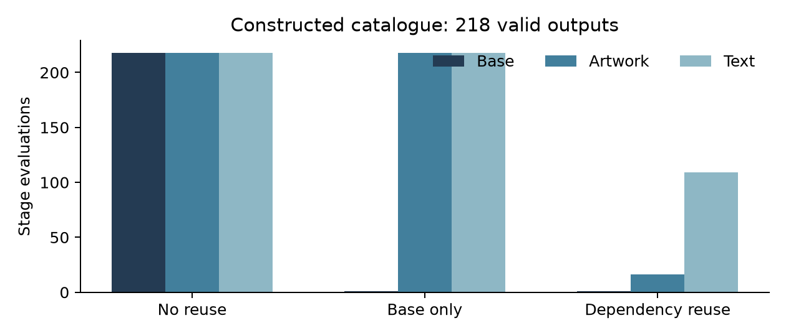

# Constraint-Aware Video Variant Compilation with Dependency-Safe Reuse

**Isaac Gili**  
Founder, Shuffll  
20 October 2026 · Technical manuscript v0.2

**Research status.** This working manuscript contains formal analysis and executed synthetic computations. It is not an arXiv submission or a peer-reviewed paper. The production campaign described below is a founder recollection; real-video comparative performance remains unmeasured.

## Abstract

Video personalization expands a campaign into assignments of products, artwork, offers, language, and layout. Treating every assignment as an independent generation request repeats work and introduces avoidable variation, whereas unrestricted reuse can silently retain obsolete assets. We formulate personalization as constrained compilation over an immutable media dependency graph. The formulation separates valid-assignment enumeration, dependency-equivalent intermediate computation, and final media verification. We establish sufficient conditions for cache soundness, give an output-sensitive accounting identity, and derive an acceptance-adjusted amortization condition that includes failed preparation. A reproducible constructed catalogue contains 576 possible assignments and 218 valid outputs. Dependency-based reuse reduces symbolic stage evaluations relative to two reference strategies; a deliberately incomplete key produces 218 stale-output counterexamples after a font revision. These are computational results about the declared graph, not measured render-time savings. We specify a paired campaign study motivated by a founder-reported 400-variant deployment and identify the independent units, baselines, negative controls, and evidence required to test commercial-video applicability.

## 1. Research question and contribution boundary

The central question is not whether a compositor can replace a logo. It is when a large set of individually correct personalized outputs can reuse work without invalidating either their content or the evidence supporting their acceptance. A campaign may replace one product, its approved artwork, a localized offer, and a call to action while retaining the same generated background. Those variables are not generally independent. An offer may apply to only a subset of products; a translated string may exceed the permitted layout; changing narration may alter scene duration.

We study an explicit compiler boundary: inputs are approved media and a typed campaign specification; outputs are assignment-specific media requests with dependency and verification records. Photorealistic object insertion into an arbitrary moving scene is outside the correctness theorem. The geometry and visibility required for such insertion belong to a separate attachment estimator. Our compiler can consume its frozen outputs without making them correct by construction.

The manuscript contributes a video-specific formalization, sufficient correctness conditions with failure examples, a small executable reference experiment, and a falsifiable evaluation design. The underlying techniques of dependency tracking, hashing, constraint satisfaction, and memoization are established. A claim of new rendering technology or a priority claim about personalized advertisements would exceed the evidence.

Three hypotheses can be tested separately. H1: dependency-aware execution reduces repeated intermediate work at identical output semantics. H2: total cost per accepted variant falls after a measurable campaign-size threshold, including preparation and QC. H3: the benefit persists against an optimized conventional template compositor. H1 does not imply H2, and a result against full regeneration alone cannot establish H3.

## 2. Related work and distinguishing comparison

Build systems provide a mature framework for separating dependency scheduling from decisions about rebuilding [1]. We adapt that perspective to media assets, fonts, timeline intervals, model outputs, and validation evidence. The adaptation has to address assets that are stochastic when created but immutable once accepted, and media specifications whose correctness cannot be decided by hashes alone.

NextAds studies personalized creative generation and integration [2]. VideoDirectorGPT uses explicit plans for multi-scene generation [3]. Both motivate structured control, but neither reference alone establishes the semantics or savings of the compiler evaluated here. Virtual product placement includes tracking and occlusion-aware integration [4]; our assignment theorem does not replace those visual methods. VBench supplies complementary video-quality dimensions [5], whereas campaign compilation additionally requires exact assignment correctness and end-to-end cost accounting.

A serious comparison therefore includes an ordinary compositor with caching enabled. Disabling that baseline's natural reuse would manufacture an advantage. For content requiring regenerated actor-product interaction, a fixed-background method may be inappropriate and should abstain or regenerate rather than report a nominal cache hit as success.

## 3. Formal model

Let the campaign specification be T = (B, D, K, G, E). B is a set of immutable base assets; D is a collection of finite slot domains; K is a conjunction of admissibility predicates; G is a directed acyclic graph of computations; E is the declared execution environment. A variant is an ordered assignment v, so two different product placements remain distinct even if they contain the same products.

$$
\mathcal{V}=\{v\in D_1\times\cdots\times D_d:K(v)=1\},\qquad N=|\mathcal{V}|.
$$

Every node j computes an intermediate z_j from its parent outputs, a projection of v, immutable external assets, and a versioned implementation. Its dependency closure includes transitive inputs. An environment record includes rasterizer, fonts, codecs, timebase, color space, numerical settings, and any randomness actually consumed. A font family name without the font bytes is insufficient.

The compiler distinguishes three identities: a semantic request identifier, an intermediate content identifier, and a measured output identifier. The first says what was requested; the second identifies a reusable input or result; the third identifies what was produced. Confusing them allows a request hash to be misrepresented as evidence of identical frames.

Define equivalence at node j by equality of the complete declared inputs to that node. This is generally finer than equality of visible product IDs and coarser than equality of the full campaign assignment.

$$
v\sim_j w\ \Longleftrightarrow\ I_j(v)=I_j(w).
$$

I_j includes the dependency closure and execution configuration. A canonical serialization uses typed values, ordered fields, normalized units, and explicit missing-value markers. Reusing a mutable URL without its retrieved content digest does not satisfy this definition.

## 4. Compilation algorithm

The method has five stages. First, validate the catalogue and freeze all externally resolved assets. Second, enumerate only assignments satisfying K, using pruning or a constraint solver when the Cartesian product is large. Third, build node keys from dependency closures and execute each distinct input class once. Fourth, assemble every required output using fresh per-variant state. Fifth, check media validity and assignment-specific acceptance, retaining rejected outputs and their costs.

```text
compile(template, catalogue, environment):
    freeze_and_digest_external_inputs()
    for assignment in enumerate_valid_assignments():
        for node in topological_order(template.graph):
            inputs = resolve_complete_inputs(node, assignment)
            key = canonical_digest(inputs, node.version, environment)
            result = cache.lookup_verified(key)
            if result is absent:
                result = execute(node, inputs)
                cache.store_atomically(key, result, observed_digest(result))
        emit_manifest(assignment, final_result, lineage, verification)
```

Stochastic generation requires a special boundary. A seed is not assumed to determine a remote provider's output. The accepted base is materialized and content-addressed; downstream reuse depends on those actual bytes. If a request is retried and returns a different base, downstream keys change even when prompt and seed do not.

Invalidation applies to QC evidence as well as pixels. Changing an offer can leave the background cache valid but invalidate a text-correctness assessment. Changing a provider revision may invalidate a calibration certificate even if one retrieved asset remains unchanged. A useful implementation therefore maintains a media graph and an evidence graph with explicit dependency edges.

## 5. Correctness and computational accounting

**Proposition 1: sufficient cache soundness.** Suppose G is acyclic; every node is a pure deterministic function of its recorded complete inputs; serialization is injective on those inputs; equality is verified without hash collisions; and cache entries are atomically associated with their outputs. Then cached and uncached evaluation produce identical node outputs for every valid assignment.

**Proof.** Process nodes in topological order. At a source, equal recorded inputs imply equal outputs by determinism. Assume equality for every parent of node j. A cache hit identifies exactly the input tuple that an uncached evaluation would consume. Purity implies equal outputs at j; a miss executes the same function. Induction gives equality at the final node. A practical cryptographic digest substitutes a negligible collision assumption for the ideal equality check. The proposition says nothing about whether the chosen inputs describe a visually acceptable advertisement.

**Counterexample.** If a key includes a font family label but excludes a changed font file, two equal keys may produce different glyph metrics. The cached output is then stale. Omitting an occlusion mask, a layout revision, or a color-transform profile creates the same structural problem.

For node j let u_j be the number of distinct dependency classes among the requested assignments, and c_j its fixed evaluation cost in a constructed accounting model. Ignoring cache lookup and storage, total work is:

$$
W_{\mathrm{reuse}}=\sum_{j\in G}u_jc_j,\qquad
W_{\mathrm{naive}}=N\sum_{j\in G}c_j.
$$

This identity is an accounting result, not an asymptotic speedup theorem. If every variant changes every node, u_j = N and reuse provides no computational advantage. Lookup, hashing, data transfer, and cache contention can make it slower. A full output stage still executes N times unless byte-identical full outputs are explicitly deduplicated.

Enumeration itself remains hard in general. Arbitrary constraints can encode combinatorial problems, and emitting N distinct manifests costs at least proportional to N. We do not claim that caching removes the combinatorial growth of the output set. For materialized keys, memory scales with the number and size of stored intermediates, not merely with the number of slot dimensions.

## 6. Cost per accepted output

Let C_0 include base generation, rejected preparation attempts, template authoring, asset preparation, and calibration work. Let c_r denote marginal reuse cost and q_r the independent per-attempt probability of an acceptable reusable rendering under a stationary simplified model. Let c_g and q_g describe full regeneration. If attempts are independent, costs are constant, and retries continue until success, expected costs for N accepted outputs are:

$$
\mathbb{E}[C_r]=C_0+N\frac{c_r}{q_r},\qquad
\mathbb{E}[C_g]=N\frac{c_g}{q_g}.
$$

Reuse breaks even only if c_g/q_g exceeds c_r/q_r, and then N must exceed C_0 divided by that difference. These assumptions often fail: failures may be correlated, budgets truncate retries, and a shared bad base can invalidate every variant. The prospective analysis must consequently report empirical total spend divided by accepted outputs alongside delivery coverage, rather than fit this simplified formula to selected successes.

For at most H identical independent attempts, delivery probability is 1-(1-q)^H and expected attempts are that probability divided by q. This yields a useful planning calculation but does not justify treating the accepted outputs of different methods as matched populations. Full accounting includes human review, storage, network transfer, repair, and deadline failures. A method that rejects difficult campaigns may look cheap per accepted output while serving fewer requests.

## 7. Executed synthetic experiment

The public standard-library script enumerates eight products, three artwork choices, four offers, three locales, and two layouts. Artwork must be product-compatible or generic; offers obey a deterministic availability rule; one locale supports only two offers and cannot use the compact layout. These are invented catalogue constraints, declared in source and not inferred from customer records.

Independent exhaustive filtering and a separately written pruned enumeration both return 218 valid assignments from 576 possibilities. Across these assignments there are 16 distinct product-artwork combinations and 109 text-layout combinations. The symbolic renderer is a pure tuple-valued function; it deliberately does not encode video.

| Strategy | Base evaluations | Artwork evaluations | Text evaluations | Final compositions | Assumed work units |
|---|---:|---:|---:|---:|---:|
| No reuse | 218 | 218 | 218 | 218 | 9439.4 |
| Reuse base only | 1 | 218 | 218 | 218 | 759.4 |
| Reuse complete dependencies | 1 | 16 | 109 | 218 | 246.4 |

**Table 1. Constructed operation counts.** The weights are 40, 2, 1, and 0.3 units for base, artwork, text, and composition respectively. They are assumptions, not milliseconds, currency, GPU measurements, or predicted Shuffll prices. The valid-output count and class counts are exact for the catalogue.



Every assignment is evaluated under two font revisions. Complete keys reproduce the uncached symbolic oracle. A key that omits the revision would reuse an incorrect result for all 218 assignments after the change. This negative control is more informative about correctness than a cache-hit percentage alone.

The experiment establishes the implementation of the declared finite example and demonstrates a concrete dependency omission. It does not establish video fidelity, production scale, cache profitability, or superiority over a competent conventional renderer. The same complete-key algorithm is expected to benefit any deterministic renderer with the same dependency structure.

## 8. Retrospective case and prospective test

Isaac Gili recalled a campaign involving 400 variants over four weeks and a QC feedback loop that chose subsequent actions using failure analysis and assessments of model abilities. This account motivates the study. We have not recovered its job ledger, output corpus, original denominators, cost records, or comparison arm. The meaning of the four-week interval is unconfirmed. It must not be converted into a render-throughput statistic.

The connected Engage development catalogue currently exposes image and video model choices; local inspection also identifies capability-aware scene routing and voice interfaces. Neither source establishes which models produced the recalled campaign. The retrospective dataset must be reconstructed from timestamps and immutable artifact/job identifiers before estimating failure or repair rates.

The proposed controlled study uses multiple independently authored templates and campaign families. For each brief, create matched assignments under: optimized conventional template composition; the dependency compiler; and independent generation where semantically applicable. Use the same approved assets and output specifications. Randomize execution order within blocks to reduce load and provider-time effects.

Primary outcomes are assignment correctness and total cost per accepted output, with request-level delivery coverage as a co-primary operational constraint. Report paired cost differences and confidence intervals clustered by template or campaign. Secondary outcomes include first-pass acceptance, stale-cache incidents, wall-clock latency, rendering throughput, and human review minutes. Frame count is not the sample size for campaign generalization.

Ablations remove intermediate reuse, omit the evidence graph, and deliberately change fonts, offers, or masks. The incomplete-key condition is a negative control and is never deployed to recipients. A benefit claim fails if it disappears against optimized baseline caching, if visually required regeneration invalidates reuse assumptions, or if QC and preparation erase the apparent savings.

## 9. Reproducibility, limitations, and scope

Run `python experiments/run_experiments.py` from the public research directory. The script writes raw CSVs and deterministic JSON with the catalogue, counts, and checks. No provider credentials, paid generation, customer data, or Shuffll production source are required. Reproduction validates the constructed accounting example only.

The formal soundness result depends on dependency completeness, which is difficult to audit in browsers, remote APIs, and hardware codecs. The reference experiment is small and symbolic. The industrial recollection has selection and recall bias. Real-video quality is not reducible to assignment syntax, and generated-base reuse can reduce creative diversity.

The work belongs to a four-manuscript research program: this paper covers compilation; the attachment paper covers geometry and compositing; the QC paper covers acceptance risk; the routing paper covers adaptive repair. Shared observations are not four independent experiments. If subsequent validation supports only one integrated contribution, a consolidated submission would be more defensible.

## Author responsibility and disclosure

Isaac Gili is Founder of Shuffll and Shuffll has a commercial interest in the subject. AI assistance supported literature discovery, formalization, coding, and drafting. Human author review of proofs, implementation, attribution, and claims remains required before scholarly submission. No measured superiority or academic priority is claimed.

## References

[1] A. Mokhov, N. Mitchell, and S. Peyton Jones. Build Systems à la Carte. ICFP, 2018. https://www.microsoft.com/en-us/research/publication/build-systems-la-carte/

[2] Y. Xu et al. NextAds: Towards Next-generation Personalized Video Advertising. 2026. https://arxiv.org/abs/2603.02137

[3] H. Lin, A. Zala, J. Cho, and M. Bansal. VideoDirectorGPT: Consistent Multi-scene Video Generation via LLM-Guided Planning. 2023. https://arxiv.org/abs/2309.15091

[4] D. Bhargavi, K. Sindwani, and S. Gholami. Zero-shot virtual product placement in videos. ACM IMX, 2023. https://www.amazon.science/publications/zero-shot-virtual-product-placement-in-videos

[5] Z. Huang et al. VBench: Comprehensive Benchmark Suite for Video Generative Models. CVPR, 2024. https://arxiv.org/abs/2311.17982
