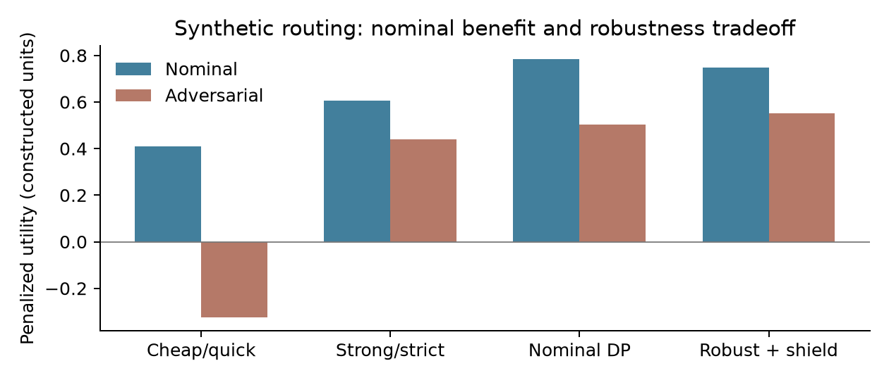

# Failure-Conditioned Control of Multimodel Video Pipelines under Quality and Budget Constraints

**Isaac Gili**  
Founder, Shuffll  
20 October 2026 · Technical manuscript v0.2

**Research status.** This manuscript develops a proposed controller and analyzes a finite synthetic decision problem. It is not an arXiv submission or a peer-reviewed publication. No observed superiority of an agent, provider, or repair policy is claimed.

## Abstract

A multimodel video pipeline contains more choices than selecting a video generator: it may revise a script, replace a reference image, regenerate motion, repair a mask, resynthesize speech, transcribe audio, or composite exact artwork. After QC detects a failure, choosing an effective local intervention requires uncertainty about the failure itself, action capability, collateral damage, and remaining budget. We formulate this process as a partially observed constrained control problem over an artifact dependency graph. The proposed design separates an agent's action proposals from typed capability checks, versioned evidence, budget reservations, and an acceptance gate. We derive budget invariance, a condition under which conditional acceptance-risk limits survive adaptive routing, and a finite-horizon robust recursion under rectangular uncertainty. In an executed constructed decision problem, the robust policy sacrifices nominal utility to improve worst-case penalized utility relative to nominal optimization; exhaustive action-sequence enumeration confirms the optimum in that reduced model. A founder-reported 400-variant campaign motivates a failure-conditioned capability study, but its model assessments and outcome logs remain unrecovered.

## 1. From model choice to repair control

Suppose QC detects malformed offer text over otherwise satisfactory footage. A text compositor can replace that layer while preserving the background. If speech contains the wrong product name, the relevant intervention may be script correction and TTS. If an object loses identity during motion, a new reference image or video model may be necessary. A global ranking of models cannot encode all these distinctions.

The research question is whether failure-conditioned routing can increase accepted delivery under fixed quality and resource constraints, while remaining auditable when the assessment is uncertain. The controller must reason about which components an action changes, which valid evidence becomes stale, and which defects it might introduce.

The proposed contribution is a typed, evidence-bearing control formulation and a concrete experiment design. Robust Markov decision processes, partial observability, action masks, model routing, and reasoning/acting agents are established. The synthetic experiment tests a restricted decision model, not the complete multimodal architecture. Its limitations are part of the result.

## 2. Prior work and comparison targets

Mora coordinates specialized components for video generation [1], and VideoDirectorGPT uses language-model planning for multi-scene video [2]. RouteLLM studies quality-cost model selection for language-model requests [3]. ReAct interleaves reasoning and tool actions [4]. These establish substantial prior art for planning and routing; adding the word "agentic" is not an independent scientific contribution.

Robust MDPs optimize decisions under uncertain transition laws [5]. We adapt finite-horizon robust control to repair attempts, with an explicit artifact graph and release gate. Statistical acceptance control follows the principles discussed in the companion QC manuscript and the Learn then Test framework [6]. Neither an LLM's self-reported confidence nor a provider's advertised capability constitutes a calibrated transition model.

The main empirical baseline should be a well-engineered fixed repair policy with equivalent tools, budgets, and QC. Comparing against an unrestricted or deliberately weak agent would confound tool access with decision quality. A nominal optimizer using the same data is necessary to isolate the value and cost of robustness.

## 3. Observed system context and evidence limits

Isaac Gili recalled 400 variants over four weeks, with a QC feedback loop that selected a next action using the failure and prior assessments of model abilities. This describes a failure-conditioned decision process, but does not identify its algorithm, calibration quality, or causal benefit. Counts of accepted artifacts, failed attempts, costs, provider revisions, and assessment records have not been supplied.

On 20 October 2026, the connected Engage development catalogue returned 19 configured image/video entries: 12 video and 7 image. Labels included Veo, Seedance, LTX, Gemini/Nano Banana, GPT Image, and provider-specific variants. These are configured choices at that observation time, not a verified catalogue of upstream public availability or a record of campaign execution.

Read-only inspection of local Engage code showed scene-over-template video selection, a last-frame capability check, image routing, and Gemini/ElevenLabs voice interfaces. A generation worker also records tried models, distinguishes transient errors from terminal rejection, and contains capability-aware fallback and persistence of a successful model choice. This establishes implemented routing logic, not visual-QC ability or deployment activation; feature-switch state was not verified. The user also identifies text, segmentation, TTS, and STT as pipeline families. Each deployed endpoint, version, permission, and runtime behavior must be verified before inclusion in an empirical benchmark. In particular, a component called segmentation may mean shot segmentation or object masking; the experiment registry must distinguish them.

## 4. State, observations, and actions

Let z_t contain the latent defect state and relevant unobserved provider condition. Let h_t be the complete observed episode history: artifact revisions, scores, detected failures, prior actions, costs, and outcomes. A belief b_t summarizes uncertainty about z_t when a validated observation model is available. An LLM narrative is not a substitute for that probability model.

The artifact graph includes script, reference image, motion clip, segmentation or tracking outputs, narration, transcription/alignment, vector layer, and final export. An action a declares its input/output types, required capabilities, affected nodes, possible collateral changes, cost and latency bounds, provider revision, and acceptance evidence. Repairing a node invalidates dependent artifacts and their QC records.

The action set includes deterministic repairs as well as stochastic model calls. A stop action is always available. A release action is separate and must satisfy a current acceptance predicate. Escalating to human review is an explicit action with its own cost, latency, and documented outcome, rather than an invisible way to improve the reported success rate.

For failure family f, action a, and context x, the capability assessment estimates the probability of resolution and of newly introduced defects. A single scalar "best model" score cannot express both. Sparse cells require uncertainty intervals or abstention; extrapolation to unseen languages or surface types must be reported.

## 5. Objective and control constraints

A policy maps observed histories to actions. Let G indicate a good terminal delivery, B a defective terminal delivery, and C total cost. One possible objective balances delivery, defects, and cost:

$$
J(\pi)=\mathbb{E}_{\pi}[G-\lambda B-\gamma C],
\qquad C\le C_{\max}\ \mathrm{pathwise},\quad T\le H.
$$

The defect penalty lambda is a preference parameter, not a guarantee. The controller therefore also imposes a separate acceptance-risk requirement and technical preconditions. A favorable expected utility must not authorize a forbidden operation or an unverified export.

Real service costs may be unknown before completion. Pathwise budget control requires a conservative reservation upper bound, including allowed retries and potential duplicate submissions. If no enforceable bound exists, the pathwise theorem cannot apply; one must use a softer budget statement or abstain from that action.

Timeouts create an important third state besides success and failure: outcome unknown. An idempotent request ledger and reconciliation step prevent automatic resubmission from duplicating spend. The agent may propose a retry, but the executor checks whether the previous operation is still unresolved.

## 6. Robust finite-horizon recursion

For a fully observed finite state s containing remaining budget, remaining attempts, and relevant artifact/evidence status, let P_sa be an uncertainty set over next states and rewards. Under state-action rectangular uncertainty, the robust value recursion is:

$$
V_h(s)=\max_{a\in\mathcal{A}_{\mathrm{safe}}(s)}
\min_{p\in\mathcal{P}_{sa}}
\mathbb{E}_{p}[r(s,a,S')+V_{h-1}(S')].
$$

Set V_0 to the terminal utility and include stop among the feasible actions. Rectangularity lets the adversary choose distributions separately for each state-action visit. It can be conservative if one persistent provider condition couples all outcomes, and it is not equivalent to optimizing over one fixed unknown model shared throughout an episode.

In the partially observed case, a belief-state construction can be used only if the transition and observation models justify that belief update. In practice we propose a coarse, audited state abstraction and conservative uncertainty sets, followed by validation of calibration conditional on state. The complete POMDP solver is not implemented in the present reference experiment.

The LLM can assist with diagnosis and action proposals, especially when textual feedback is heterogeneous. Typed tools and the controller determine feasibility; an unparseable or unsupported proposal becomes an explicit rejection. The proposal model should never silently change the cost bound, acceptance threshold, or evidence version.

## 7. Two useful invariants

**Proposition 1: budget and termination.** If an action executes only after an atomic reservation no larger than remaining budget, actual charged cost is bounded by that reservation, and each nonterminal action decreases a finite attempt counter, then total cost never exceeds the initial budget and the episode terminates after at most H actions.

**Proof.** Remaining budget begins nonnegative. Subtracting a reservation no larger than the current amount preserves nonnegativity; settling at or below the reservation cannot increase total charged cost beyond the initial allocation. The attempt counter is a nonnegative integer that strictly decreases on every nonterminal action. Induction establishes both claims. Concurrent jobs require atomic reservations; a preflight read alone is insufficient.

**Proposition 2: preservation of conditional acceptance risk.** At every reachable history h and chosen action a, suppose the probability q_B(h,a) of defective terminal acceptance satisfies q_B(h,a) at most alpha times q_A(h,a), where q_A is the probability of any terminal acceptance at that step. Suppose an episode delivers at most one artifact. Then its overall selective defect risk is at most alpha whenever delivery has positive probability.

**Proof.** Weight the stepwise inequality by the probability of reaching each history and sum over disjoint terminal acceptance events. The left sum is total defective-delivery probability; the right sum is alpha times total delivery probability. Divide by the positive delivery probability. Within-episode independence is unnecessary.

The second condition is strong. A marginal certificate for a model on ordinary prompts does not establish a conditional guarantee after repeated difficult failures. A router can select exactly the subset where a model's marginal calibration is wrong. We therefore prefer calibrating the full frozen episode policy unless validated conditional bounds are available.

## 8. Capability assessment and repair policy

The proposed assessment dataset contains controlled failure instances with a pre-intervention artifact, a blinded defect label, candidate actions, complete execution receipts, and post-intervention labels. Each action is assessed for defect resolution, collateral defects, accepted delivery, cost, and latency. Randomized assignment among eligible actions is preferable to inferring abilities from a policy that always sends the hardest jobs to one model.

A capability table should be indexed by failure family and context, not just provider. Record text overflow, logo corruption, identity drift, motion inconsistency, incorrect pronunciation, timing mismatch, and mask leakage separately. An action may resolve one defect and create another; the terminal acceptance endpoint remains necessary.

```text
for each bounded episode:
    inspect current artifact and current QC evidence
    infer a failure set with recorded uncertainty
    enumerate typed actions eligible for this artifact revision
    reject stale evidence, unmet capabilities, and unaffordable actions
    choose using a frozen robust or baseline decision policy
    reserve budget; execute once; reconcile uncertain outcomes
    invalidate dependent artifacts and evaluate the revised result
    release only after the terminal acceptance gate; otherwise stop
```

The policy may choose an additional diagnostic action when its expected value justifies its cost. For example, rerunning alignment can distinguish a script mismatch from a timing error before resynthesizing speech. Such information-gathering actions must be included in the budget and evaluation, not treated as free reasoning.

## 9. Executed restricted decision experiment

The reference environment has four abstract actions combining a cheap or strong generator/repairer with a quick or strict verifier. These names identify invented probability intervals; they are not aliases for actual providers. At an attempt, g is candidate-good probability, s is verifier acceptance probability given a good candidate, and f is acceptance probability given a bad candidate.

$$
q_G=gs,\qquad q_B=(1-g)f,\qquad q_R=1-q_G-q_B.
$$

A rejection returns to the decision state with lower budget and one fewer attempt. There is no diagnostic observation beyond rejection, so this experiment isolates budget/robustness mechanics and does not test failure-conditioned diagnosis.

| Action | Cost units | g interval | s interval | f interval |
|---|---:|---|---|---|
| Cheap + quick | 1 | [0.55, 0.85] | [0.90, 0.98] | [0.08, 0.15] |
| Cheap + strict | 2 | [0.55, 0.85] | [0.70, 0.90] | [0.005, 0.02] |
| Strong + quick | 3 | [0.80, 0.95] | [0.90, 0.98] | [0.08, 0.15] |
| Strong + strict | 4 | [0.80, 0.95] | [0.70, 0.90] | [0.005, 0.02] |

**Table 1. Assumed environment.** The initial budget is six units and the cap is three attempts. Utility is G-10B-0.02C. The shield requires worst-case per-attempt accepted-defect fraction at most 0.03. Nominal parameters are interval midpoints. Multiaffinity makes evaluating the eight interval corners sufficient for each robust expectation in this constructed model.

| Policy | Nominal utility | Adversarial utility | Adversarial good delivery | Adversarial accepted defect fraction |
|---|---:|---:|---:|---:|
| Fixed cheap + quick | 0.410802 | -0.325781 | 0.806309 | 0.120000 |
| Fixed strong + strict | 0.604375 | 0.440000 | 0.560000 | 0.007092 |
| Nominal dynamic program | 0.784817 | 0.503175 | 0.759696 | 0.022843 |
| Robust shielded dynamic program | 0.748371 | 0.551180 | 0.727860 | 0.010769 |

**Table 2. Exact finite-model evaluation.** Each adversary minimizes that policy's stated utility within rectangular uncertainty; the rows are not measurements in one common observed provider condition. They are computed from Table 1, without generated media or Monte Carlo uncertainty.



The robust policy begins with strong+strict and may use cheap+strict after rejection; the nominal policy begins with cheap+strict. Robustness improves its worst-case penalized objective but decreases nominal utility. It does not dominate all metrics: the nominal policy has higher good-delivery probability in the reported adverse evaluation. Both adaptive policies happen to meet the 3% accepted-risk threshold here; the shield is not necessary for the nominal policy in this particular example.

An independent exhaustive enumeration of all affordable shield-eligible action sequences matches the robust dynamic program. The script also checks every small budget/horizon state and independently evaluates the chosen policy. This supports the implementation of the reduced recursion. It does not validate an LLM agent, a learned capability matrix, state abstraction, or a real-video quality guarantee.

## 10. Failure-conditioned intervention experiment

A second finite experiment isolates the usefulness and fragility of diagnosis. Three latent failure classes - motion, artwork, and speech - have equal prior probability. The assessment returns the correct class with probability q and each incorrect class with probability (1-q)/2. Four actions have the assumed resolution vectors and collateral-defect probabilities below. A good result requires both resolution and absence of the independently assumed collateral defect.

| Action | Cost | Resolution: motion / artwork / speech | Collateral defect |
|---|---:|---|---:|
| Regenerate | 4 | 0.85 / 0.65 / 0.45 | 0.040 |
| Repair motion | 3 | 0.88 / 0.15 / 0.05 | 0.030 |
| Repair artwork | 1 | 0.05 / 0.97 / 0.02 | 0.005 |
| Repair speech | 1 | 0.03 / 0.02 / 0.96 | 0.010 |

**Table 3. Invented capability matrix.** The objective is probability of a good result minus 0.06 times cost. These values are study assumptions; they do not characterize Engage models.

The nominal policy assumes q=0.85 and selects the corresponding local repair for each diagnosis. The robust policy assumes q in [0.6,0.9], evaluates the worst endpoint for each observed diagnosis, and chooses regeneration for motion, artwork repair for artwork, and speech repair for speech. The best diagnosis-independent action is regeneration. Exhaustive enumeration of all 64 diagnosis-to-action maps verifies the two optimized policies.

| Policy | Good result at q=0.85 | Utility at q=0.85 | Good result at q=0.40 | Utility at q=0.40 |
|---|---:|---:|---:|---:|
| Best fixed action | 0.624000 | 0.384000 | 0.624000 | 0.384000 |
| Nominal diagnosis policy | 0.792421 | 0.692421 | 0.400535 | 0.300535 |
| Robust diagnosis policy | 0.803318 | 0.683318 | 0.481722 | 0.361722 |

**Table 4. Exact one-intervention outcomes in a common constructed environment.** The robust policy uses more mean cost than the nominal local-repair policy, explaining why its higher good-result probability at q=0.85 does not produce higher utility. At q=0.40 both diagnosis policies lose to the fixed action on the objective. This value lies outside the robust policy's assumed uncertainty interval.

The negative result is central: a capability-aware controller can be inferior when its failure assessment is wrong, and robustness protects only against conditions represented in its uncertainty set. The experiment does not implement a learned diagnostic model, multi-step belief updates, an acceptance gate, or a real-media repair. It complements rather than validates the complete proposed controller.

## 11. Proposed failure-conditioned evaluation

Reconstruct the reported campaign as complete episodes, not isolated successful exports. Retain original briefs, template family, action eligibility, selected model revision, failure assessment, chosen repair, every charged call, and terminal disposition. Unknown or missing outcomes remain unknown. Four weeks cannot be interpreted as compute time without timestamp evidence.

For a prospective study, block by campaign and failure family. Compare bounded same-model retries, a fixed expert repair tree, nominal capability routing, robust capability routing, and an LLM proposal system under the same shield. Use the same tools and QC rubric for all arms. Randomize eligible repair decisions where feasible; compare complete episode outcomes to avoid favoring policies that merely defer difficult jobs.

Primary outcomes are accepted-defect risk and budget-constrained delivery. Secondary outcomes include cost, latency, collateral defects, human intervention, retries, and stale-evidence incidents. Split by campaign and time, with a held-out provider revision or model family as a shift challenge. Report uncertainty at the campaign level.

Ablations remove failure conditioning, uncertainty intervals, local repair actions, evidence invalidation, or the acceptance gate. Stress tests include ambiguous defects, conflicting judges, unknown job completion, provider failures, unsupported last-frame requirements, and model changes. A robust-policy claim fails if its advantage disappears after controlling for tool access, human help, or different acceptance rules.

Off-policy retrospective estimates require known action propensities and adequate overlap. If the historical policy never tried an alternative on a class of failures, logs alone cannot identify that alternative's outcome. In that situation the case study remains descriptive and new randomized tests are needed.

## 12. Limitations, reproducibility, and disclosure

Rectangular uncertainty may be pessimistic; under-specified uncertainty may be dangerously optimistic. Capability assessments can age quickly and be confounded by difficulty. Diagnoses can be wrong, and local repairs can interact. The full proposed controller requires substantial empirical work beyond the small executed model.

Run `python experiments/run_experiments.py` to reproduce action intervals, policy tables, exact outcomes, and oracle checks. The published code has no provider integration or access to production assets. No synthetic interval should be entered into a real capability registry as measured evidence.

Isaac Gili is Founder of Shuffll, which has a commercial interest in this work. AI assistance supported literature review, formalization, coding, and drafting. Human author verification remains required. The four manuscripts share one research program and case-study lead; publication should not imply four independently validated deployments.

## References

[1] Z. Yuan et al. Mora: Enabling Generalist Video Generation via A Multi-Agent Framework. 2024. https://arxiv.org/abs/2403.13248

[2] H. Lin, A. Zala, J. Cho, and M. Bansal. VideoDirectorGPT: Consistent Multi-scene Video Generation via LLM-Guided Planning. 2023. https://arxiv.org/abs/2309.15091

[3] I. Ong et al. RouteLLM: Learning to Route LLMs with Preference Data. 2024; revised 2025. https://arxiv.org/abs/2406.18665

[4] S. Yao et al. ReAct: Synergizing Reasoning and Acting in Language Models. 2022. https://arxiv.org/abs/2210.03629

[5] A. Nilim and L. El Ghaoui. Robust Markov Decision Processes with Uncertain Transition Matrices. UC Berkeley technical report, 2004. https://www2.eecs.berkeley.edu/Pubs/TechRpts/2004/4236.html

[6] A. N. Angelopoulos et al. Learn then Test: Calibrating Predictive Algorithms to Achieve Risk Control. 2021; revised 2022. https://arxiv.org/abs/2110.01052
