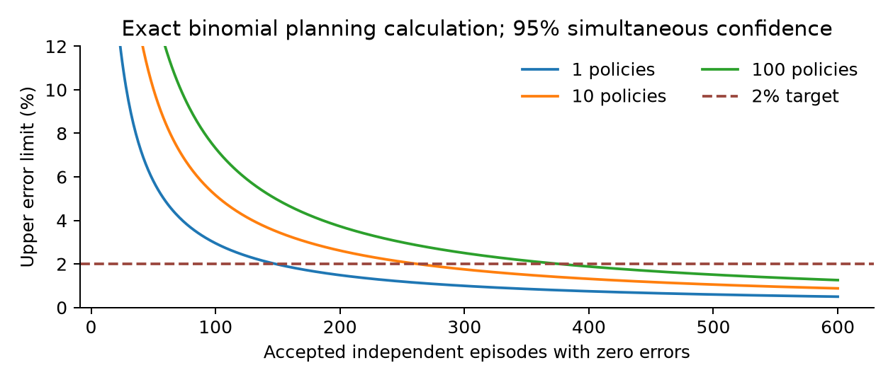

# Quality Control for Stochastic Video Pipelines: Selective Risk, Correlated Variants, and Adaptive Repair

**Isaac Gili**  
Founder, Shuffll  
20 October 2026 · Technical manuscript v0.2

**Research status.** This manuscript presents a proposed application of established statistical methods, derivations, and executed synthetic calculations. It is not an arXiv submission or a peer-reviewed publication. No real-video defect-rate guarantee has been established.

## Abstract

Stochastic video systems require quality control over the outputs they deliver, not merely a ranking of candidate clips. Repeated generation, model switching, shared templates, and adaptive acceptance rules complicate this requirement: frames are dependent, selected outputs differ from raw candidates, and successful calibration can disappear after workflow changes. We formulate quality control as selective prediction over complete generation-and-repair episodes, distinguishing delivered-output defect risk, delivery coverage, and request-level failure. We adapt exact one-sided binomial bounds to a finite set of frozen acceptance policies and derive a bounded-cluster alternative for correlated campaign variants. We also give a total-variation sensitivity bound that makes the fragility of low-coverage guarantees explicit. Reproducible exact calculations show that certifying a 2% defect target with zero observed errors and 95% confidence requires 149 accepted independent episodes for one policy, 263 for ten candidates, or 377 for one hundred under Bonferroni correction. These sample requirements are not performance estimates. A founder-reported 400-variant campaign motivates a retrospective protocol and a prospective benchmark spanning visual, semantic, artwork, speech, timing, and execution failures.

## 1. Quality control as a decision problem

A video can look polished while containing the wrong price, a corrupted logo, an omitted product, mispronounced speech, or a misplaced call to action. An aggregate aesthetic score is therefore inadequate as the sole release criterion. Conversely, a detector's low confidence is not itself proof of a defective video. Operational QC must decide whether to accept, repair, retry, or abstain while recording which requirement remains unresolved.

The research question is how to attach an interpretable statistical statement to a complete workflow whose generator and critic are imperfect. We study a deployment-specific binary endpoint: whether a delivered artifact violates at least one predeclared material requirement. Severity-weighted losses can supplement this endpoint, but a favorable average must not conceal a categorical requirement such as exact offer text.

Our contribution is a workflow-level formulation and an evaluation protocol linking selective risk to adaptive repair and shared-template dependence. Exact binomial intervals, multiple-testing correction, concentration inequalities, and risk-control frameworks are established methods. We do not claim to invent them or to derive quality assurance from an uncalibrated model score.

## 2. Prior work and the missing operational estimand

VBench decomposes video evaluation into multiple quality and alignment dimensions [1]. VBench-2.0 extends evaluation toward intrinsic faithfulness [2]. VideoScore learns automatic feedback from human video judgments [3]. These are useful scoring and diagnostic components, but a benchmark score alone does not specify the probability that an accepted campaign output violates its release criteria.

Learn then Test formulates risk calibration through hypothesis testing [4]. Conformal Risk Control studies risk guarantees for suitable losses [5]. We use a simple finite-family, exact-binomial construction to make the selected-output estimand explicit, with exact confidence limits documented by NIST [6]. Repeated inspection over time requires additional care; confidence-sequence methods address time-uniform inference [7], whereas the fixed-sample intervals used here do not.

The distinction matters in practice. A detector may correlate well with human ratings and still miss rare incorrect offers. A threshold calibrated before adding a best-of-five selection step need not certify the selected winners. A QC model trained and evaluated on near-identical templates may appear accurate while failing on new campaigns.

## 3. Episodes, acceptance, and endpoints

An episode begins with a brief and approved assets and ends when the workflow delivers one artifact or abstains. It includes all generation calls, candidate selection, critiques, repairs, and retries. Let X describe the brief and observable history, Y the reference defect label of the terminal artifact when one exists, and A_lambda the acceptance indicator under frozen policy lambda. Y = 1 means a material defect.

For a policy with positive acceptance probability, define selective risk R, coverage kappa, and request-level defect probability D:

$$
R_\lambda=\Pr(Y=1\mid A_\lambda=1),\quad
\kappa_\lambda=\Pr(A_\lambda=1),\quad
D_\lambda=\Pr(Y=1,A_\lambda=1)=\kappa_\lambda R_\lambda.
$$

These quantities answer different questions. Low D can result from accepting almost nothing. Low R among accepted outputs does not guarantee good delivery coverage. Both must accompany cost per accepted output, latency, and abstention rates. If no outputs are accepted, R is undefined rather than zero.

The policy definition includes provider revisions, prompts, selection logic, allowed repairs, retry cap, judge versions, and thresholds. Updating any of these may change the terminal distribution. A study must identify whether it calibrates a single generated candidate or the final artifact of the full policy. Our main claim concerns the latter.

## 4. Failure taxonomy and measurement design

We propose six separately recorded failure families. Technical failures cover decode errors, incomplete duration, missing streams, and export failures. Semantic failures cover missing or incorrect requested content. Identity and artwork failures cover logos, product appearance, typography, and exact strings. Temporal failures cover flicker, discontinuity, drift, and action inconsistency. Audio failures cover speech content, pronunciation, intelligibility, and timing. Integration failures cover occlusion, alignment, color, and cross-modal synchronization.

Several failures can coexist. The label taxonomy is multi-label even when the primary release endpoint is binary. The reference rubric must specify materiality before examining comparative outcomes. Model-based scores, OCR, speech recognition, signal checks, and human review are observations; none is automatically the ground truth.

A reference panel should be blinded to provider and policy. Two independent raters can label a shared subset, followed by adjudication under a fixed rubric. Report disagreement by category and retain ambiguous cases. Speech-to-text agreement with the script does not establish pronunciation quality; OCR agreement does not establish correct logo geometry.

Reference labels should be collected for rejected as well as accepted samples in a diagnostic subset. Otherwise the study cannot estimate over-rejection or diagnose score errors. Acceptance-risk estimation uses the accepted population, while coverage and false-rejection analysis require the entire eligible request set.

## 5. Finite-family selective-risk calibration

Before calibration, use a disjoint tuning set to freeze M candidate policies. Collect n independent, identically distributed episodes from the intended deployment distribution for each policy, or evaluate all policies on a valid shared experimental design. For policy lambda, let n_lambda be the accepted count and k_lambda the number of defective accepted outputs. Shared data can correlate the policy estimates; the union bound below does not require independence across policies.

Conditional on the accepted count, iid episode sampling and a fixed acceptance policy give a binomial accepted-error count with parameter R_lambda. For n_lambda > 0 and k_lambda < n_lambda, define the one-sided upper bound U as the solution to:

$$
\sum_{i=0}^{k_\lambda}{n_\lambda\choose i}
U_\lambda^i(1-U_\lambda)^{n_\lambda-i}=\delta/M.
$$

Set U = 1 when no outputs are accepted or every accepted output is defective. Certify only policies with U no greater than the predeclared risk tolerance alpha. Among certified policies, a coverage or cost criterion may select a policy using the same calibration outcomes because the risk bounds hold simultaneously. That selection does not provide an unbiased estimate of its coverage or cost; report those on an independent test set.

**Proposition 1: simultaneous selective-risk control.** Under the fixed-policy and iid episode assumptions, with probability at least 1-delta over calibration, every certified positive-coverage policy has selective risk at most alpha.

**Proof.** Exact one-sided binomial coverage gives probability at most delta/M that the upper bound for any specified policy falls below its true selective risk. This remains valid after averaging over its random accepted count. A union bound over M policies bounds the probability of any undercoverage by delta. On the complementary event, selecting a policy with U at most alpha implies its true R is at most alpha. This is an application of established exact inference and multiple-testing logic, not a new distribution-free theorem.

The guarantee fails if the M policies are repeatedly redesigned using the calibration labels without accounting for that search. It also fails under label error unless the claimed endpoint explicitly refers to the noisy labeling process or an additional validated error correction is included.

## 6. Why frames and shared variants cannot be pooled naively

A single video may contain thousands of nearly dependent frames. Four hundred personalized outputs may share a defective base, a font, a voice, a prompt family, or one provider outage. Counting those items as independent Bernoulli trials can produce a narrow interval with no stated coverage guarantee.

One conservative option is to define one binary endpoint per independent campaign: whether it delivered any material defect. That changes the estimand to campaign-level failure. Another is to sample one accepted variant from each independently sampled eligible campaign, which estimates the risk of a typical sampled campaign's accepted variant, not automatically the output-volume-weighted deployment risk.

A bounded-cluster construction can target output-weighted risk while allowing arbitrary within-campaign dependence. Let campaigns be iid, each with at most L eligible outputs, where L is fixed in advance. For policy lambda, define B_i as defective accepted outputs divided by L and A_i as accepted outputs divided by L. Both lie in [0,1]. The desired long-run output-weighted risk is E[B_i]/E[A_i], provided the denominator is positive.

$$
\epsilon=\sqrt{\frac{\log(2M/\delta)}{2n}},\qquad
U^{\mathrm{cluster}}_\lambda=
\min\left(1,\frac{\overline{B}_\lambda+\epsilon}
{\overline{A}_\lambda-\epsilon}\right).
$$

Use U = 1 if the denominator is nonpositive. Here n is the number of independent campaigns, not the number of variants or frames.

**Proposition 2: bounded-cluster upper bound.** Simultaneously for M frozen policies, the displayed ratio is an upper bound on output-weighted risk with probability at least 1-delta, under iid bounded campaigns.

**Proof.** Apply the one-sided Hoeffding inequality to each campaign-level mean, once upward for B and once downward for A. Union-bound the 2M deviations. On the resulting event, the numerator mean is no larger than its upper bound and the denominator mean no smaller than its positive lower bound. Division preserves the ordering. No independence among outputs within a campaign is needed.

The bound is often conservative, especially when campaigns are small relative to L or acceptance is rare. This is a reason to collect better independent evidence, not to substitute frame counts. A single recalled campaign cannot support this population-level calibration.

## 7. Adaptive retries, stopping, and distribution change

A frozen policy may adapt within an episode: it can inspect a failure and choose another model or a deterministic repair. If complete episodes remain iid and the adaptation rule is fixed before calibration, Proposition 1 applies to their terminal outcomes. It does not require independent attempts within an episode.

This observation does not authorize unlimited changes between episodes. Learning new model abilities online, changing the retry cap, or replacing the QC judge changes the policy being certified. Treat such changes as versioned interventions, use a fresh calibration set, or apply an explicitly justified online-inference method. Ordinary fixed-sample intervals cannot be repeatedly checked until one happens to pass.

Distribution shift is especially damaging at low coverage. Suppose the joint episode law changes from P to Q by total variation at most eta, P-coverage is at least kappa greater than eta, and P-selective risk is at most alpha. For the fixed acceptance policy:

$$
R_Q\le\min\left(1,\frac{\kappa\alpha+\eta}{\kappa-\eta}\right).
$$

**Derivation.** Total variation changes the bad-and-accepted event probability by at most eta and the accepted-event probability by at most eta. If the original acceptance probability is a, the ratio is bounded by (a alpha+eta)/(a-eta). This decreases with a for eta positive, so substituting the lower bound kappa gives the expression. The bound requires control of the joint labeled distribution; a feature-only drift detector does not establish eta.

This result motivates monitoring coverage and per-stratum failure rates, but does not by itself give a valid drift detector. A new model family, language, product geometry, or provider revision can require separate evaluation.

## 8. Executed numerical study

The public script computes exact upper confidence limits by numerically inverting binomial cumulative probabilities, with a closed-form cross-check for zero errors. It also enumerates the full binomial sampling distribution for 18 combinations of sample size and true risk; each undercoverage probability is at most 0.05 up to numerical tolerance. These are finite numerical checks, not a replacement for the statistical argument.

For zero observed errors, U = 1-(delta/M)^(1/n). At alpha = 0.02 and delta = 0.05:

| Frozen candidate policies | Minimum accepted independent episodes with zero errors | U at n=200 | U at n=500 |
|---|---:|---:|---:|
| 1 | 149 | 0.014867 | 0.005974 |
| 10 | 263 | 0.026144 | 0.010541 |
| 100 | 377 | 0.037291 | 0.015087 |

**Table 1. Exact sample-requirement calculation.** Zero errors is a hypothetical calibration outcome; it is not an observed result from the recalled campaign. One or more errors increase the required evidence. These are accepted counts, so lower delivery coverage requires more total episodes.

As a separate multiplicity illustration, twenty independent tests each with a 5% false-positive probability have probability 1-0.95^20, approximately 64.2%, of at least one false positive. Real policy tests are usually dependent, so this value is an illustrative constructed example, not a measured QC false-pass rate.

The numerical package records inputs and results in CSV and JSON. No generated-video dataset, human annotations, provider calls, or claimed video-quality improvement is hidden behind these calculations.

## 9. Campaign study and falsifiable experiments

The founder reports 400 variants over four weeks with failure-dependent model selection after model-ability assessments. The account identifies a plausible adaptive workflow but supplies no denominator of attempts, defect labels, or accepted outputs. We will reconstruct episodes from logs, retaining all retries and abandoned branches. The calendar meaning of four weeks remains unresolved.

The prospective study should compare single-candidate thresholding; fixed best-of-H generation; bounded same-model retries; failure-aware cross-model or component repair; and a human-review reference workflow. Freeze each policy before calibration. Divide data by campaign family into tuning, calibration, and test partitions; keep related variants together.

Primary outcomes are delivered-output material-defect risk and coverage at a fixed budget. Secondary outcomes are category-specific errors, review time, retries, cost, latency, and calibration efficiency. Include a new-provider/version or new-language shift split. No guarantee should be extended to an untested stratum merely because the pooled score looks favorable.

Ablations remove multiplicity correction, replace episode counts with frame counts, or introduce post-calibration policy changes. These deliberately invalid analyses belong in methodological sensitivity demonstrations, never in production certification. They expose how apparent confidence can be inflated.

Human-label uncertainty, selective logging, and unobserved failed jobs are threats to validity. If only successful exports survive, the data cannot identify delivery coverage or total cost without an independent request ledger. A causal improvement claim also needs randomization or justified causal assumptions, not only before/after averages from an evolving campaign.

## 10. Limits and research status

The framework certifies a defined error rate under specified assumptions; it cannot guarantee that an individual video is correct. Extremely rare defects require much larger independent samples. Misleading human labels, unrecognized distribution shift, and model/critic shared blind spots can invalidate the operational interpretation.

The most substantive next experiment is an independently labeled, campaign-separated evaluation of the entire QC-and-repair loop. The present contribution is methodological specification and reproducible numerical analysis. The 400-variant account remains a case-study lead until records are recovered. It is shared context for the four manuscripts, not four separate empirical datasets.

## Reproducibility and disclosure

Run `python experiments/run_experiments.py` to regenerate the exact numerical study. `qc_results.csv` and `qc_coverage_results.csv` contain all reported inputs and outputs. Prediction scenarios are kept outside observed-result tables.

Isaac Gili is Founder of Shuffll and the company has a commercial interest in the topic. AI assistance supported literature discovery, analysis, code, and drafting. Human author review of claims and proofs remains necessary before any scholarly submission.

## References

[1] Z. Huang et al. VBench: Comprehensive Benchmark Suite for Video Generative Models. CVPR, 2024. https://arxiv.org/abs/2311.17982

[2] D. Zheng et al. VBench-2.0: Advancing Video Generation Benchmark Suite for Intrinsic Faithfulness. 2025. https://arxiv.org/abs/2503.21755

[3] X. He et al. VideoScore: Building Automatic Metrics to Simulate Fine-grained Human Feedback for Video Generation. 2024. https://arxiv.org/abs/2406.15252

[4] A. N. Angelopoulos, S. Bates, E. J. Candès, M. I. Jordan, and L. Lei. Learn then Test: Calibrating Predictive Algorithms to Achieve Risk Control. 2021; revised 2022. https://arxiv.org/abs/2110.01052

[5] A. N. Angelopoulos et al. Conformal Risk Control. 2022. https://arxiv.org/abs/2208.02814

[6] NIST. Exact Binomial Confidence Limits. https://itl.nist.gov/div898/software/dataplot/refman2/auxillar/exacbici.htm

[7] S. R. Howard et al. Time-uniform, nonparametric, nonasymptotic confidence sequences. 2018; Annals of Statistics, 2021. https://arxiv.org/abs/1810.08240
