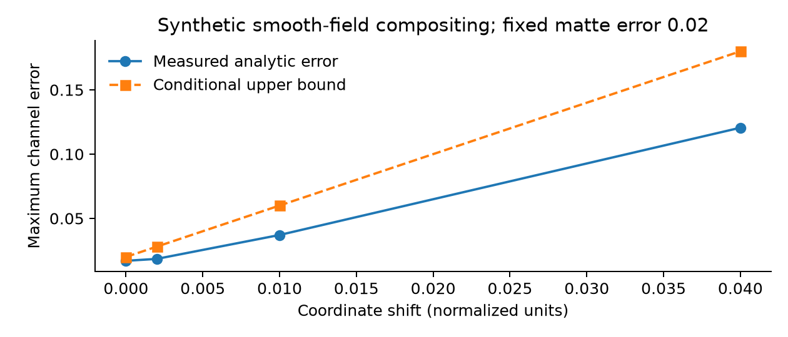

# Reproducible Vector-Art Attachment to Stochastic Video: Error Budgets, Dependency Contracts, and Selective Rendering

**Isaac Gili**  
Founder, Shuffll  
20 October 2026 · Technical manuscript v0.2

**Research status.** Formal analysis and synthetic numerical experiments accompany a proposed attachment architecture. This is not an arXiv submission or a peer-reviewed paper. No tracker accuracy, real-video benchmark, or renderer cost advantage has been measured in this study.

## Abstract

Generated video can provide plausible motion while failing to preserve exact typography, logos, and product artwork. Attaching immutable vector assets after generation separates stochastic scene creation from controlled graphical rendering, but this separation does not eliminate errors in geometry, occlusion, timing, or color. We formulate an attachment record that freezes these estimated quantities and distinguishes request, raster, and encoded-file repeatability. We derive a compositing error bound for bounded continuous foregrounds and explicit geometry and matte uncertainties; a discontinuous-edge counterexample shows why unrestricted pixel-error guarantees fail for sharp graphics. We propose selective rendering based on a declared error budget, with abstention when estimation uncertainty exceeds the permitted region. A reproducible analytic-layer experiment evaluates four geometric perturbations over 4,225 spatial points each and checks the bound numerically. The result validates the constructed calculation, not a production vector renderer. A prospective benchmark specifies controlled motion, tracked real clips, generated clips, occlusion strata, exact-artwork checks, and equal-quality cost comparisons.

## 1. Problem formulation

A generated clip and an approved vector logo solve different problems. The clip supplies appearance and motion; the vector supplies exact geometry, color, and text semantics. Recreating the logo with a generative model makes exactness a stochastic outcome. Rendering the vector afterward removes that particular source of variation, while introducing a registration problem: where and how should each vector point appear in each frame?

The research question is whether a reusable attachment contract can make these errors observable and bounded enough to support economical repeated personalization. A correct contract must distinguish an authored screen overlay, a planar surface placement, and a nonrigid attachment. The first may need only a known transform. The second needs reliable surface motion and visibility. The third may require dense correspondence or a deformable representation. Results in one regime do not establish performance in the others.

The contribution explored here is an error-budget formulation around existing estimators and compositors. We do not claim a new segmentation model, tracking algorithm, vector format, or alpha-compositing rule. The paper's theoretical statements are conditional consequences of explicit assumptions, followed by numerical checks and a protocol for testing those assumptions.

## 2. Relationship to prior methods

Porter and Duff established compositing algebra for separately rendered elements [1]. Modern placement systems already combine tracking, visibility, and appearance treatment; zero-shot virtual product placement is a direct baseline [2]. Motion vectorization recovers editable graphical programs from motion-graphics video [3], while LiveSVG uses generated video to guide SVG animation [4]. These works make claims of inventing vector animation or graphical video editing untenable here.

SAM 2 provides promptable image/video segmentation [5], and CoTracker3 provides point trajectories [6]. They are examples of possible estimation components, not certified attachment outputs. A point track can be temporally smooth yet lie on the wrong surface. A segmentation mask can be stable yet obscure a logo incorrectly.

Our proposed comparison asks whether freezing these estimates into a reproducible, uncertainty-bearing record improves exact-artwork fidelity, diagnosis, and reuse at a fixed acceptance standard. It must include a conventional tracked compositor using the same estimator. Otherwise a quality difference may be attributable to segmentation or tracking rather than the attachment contract.

## 3. Attachment contract and coordinate conventions

Let B_t(x) be the background color at image coordinate x and frame t. Let F(u) and a(u) describe a vector asset's rasterized color and opacity in canonical asset coordinates u. A forward transform maps asset coordinates to image coordinates; rendering uses an inverse sampling map phi_t from image coordinates to the asset. Confusing these directions is a common source of registration errors.

An attachment record contains the base-asset digest, vector/font digests, frame timestamps, coordinate units, inverse maps or meshes, visibility masks, layer order, color transforms, rasterization settings, uncertainty estimates, and estimator/renderer versions. All references resolve to immutable content. Time is represented on an explicit rational timebase; frame index is not interchangeable with wall-clock seconds under variable frame rate.

For a planar surface, a nonsingular homography can represent the map over its valid region. The record should include conditioning diagnostics and reject points near unstable projective denominators. For nonrigid surfaces, use a different declared model and report its interpolation assumptions. We do not extend planar guarantees by relabeling a dense warp as a homography.

The effective matte m_t(x) combines rasterized asset opacity and visibility. It is a value in [0,1], not merely a Boolean foreground mask. In linear-light color coordinates, the opaque-background composite is:

$$
C_t(x)=m_t(x)F(\phi_t(x))+(1-m_t(x))B_t(x).
$$

A practical implementation may store premultiplied colors, but must use algebra consistent with that representation. Applying opacity twice creates halos; mixing gamma-encoded and linear-light channels changes blend appearance. The contract explicitly records the choice and its conversion functions.

## 4. Three meanings of determinism

**Request repeatability** means that the same immutable specification produces the same normalized job description. **Raster repeatability** means that repeated rendering produces identical decoded frame samples or meets a declared numerical tolerance. **Container repeatability** means that encoded files have identical bytes. None follows automatically from the previous level.

Different encoders can produce different byte streams with identical decoded images. Different GPU kernels can introduce floating-point differences. Font substitution can alter glyphs while preserving an asset identifier. Remote generation may change despite a nominally identical seed. Therefore the stochastic base is retrieved and frozen before downstream repeatability is tested.

An experiment must state the level it measures. We recommend comparing lossless intermediate frames for raster tests and recording codec, metadata, threading, hardware, library revisions, and timestamps for file tests. A decoded-frame tolerance also needs a color-space and bit-depth definition. "Deterministic" without these details is not an experimental outcome.

## 5. A conditional error bound

Suppress t and x for clarity. Let the true composite use F, B, m, and phi, and the implemented composite use corresponding hatted quantities. All color channels and mattes lie in [0,1]. Assume the true foreground is L-Lipschitz in its sampling coordinate under the chosen norms. Suppose geometry error is at most epsilon_phi, matte error at most epsilon_m, and foreground/background implementation errors at most epsilon_F and epsilon_B. Let epsilon_R bound any additional numerical raster/composite error.

$$
\|\widehat C-C\|_\infty
\le L\epsilon_\phi+\epsilon_m+\epsilon_F+\epsilon_B+\epsilon_R.
$$

**Proposition 1.** Under the preceding assumptions, the stated bound holds pointwise wherever both coordinate maps are valid.

**Proof.** Add and subtract the composite using the estimated matte but true color fields and true coordinate. Changing the foreground coordinate changes its color by at most L epsilon_phi; multiplying by a matte no greater than one cannot enlarge this bound. Changing the matte multiplies F-B, whose channel magnitude is at most one. Foreground and background implementation changes contribute at most their respective uniform bounds because their mixture weights are in [0,1]. Add the raster/composite residual and apply the triangle inequality. The argument does not estimate any of the epsilon terms.

The expression can be tighter when local contrasts and matte weights are known. Its intentionally conservative form makes error allocation explicit: a nominally perfect vector file does not compensate for a large visibility error. Conversely, a small geometric displacement can dominate near high-frequency artwork because L is large.

For multiple overlaid layers, recursively applying the same reasoning yields an additive upper bound under nonexpansive alpha blending, with each foreground's geometry and color terms included. This bound may be loose. Layer-order changes are discrete semantic changes and are not covered by a small geometric perturbation bound.

## 6. Boundaries, occlusion, and abstention

A sharp indicator edge has no finite global Lipschitz constant. Consider a black-white step at coordinate 0.5. Moving it by 0.001 can change a pixel from zero to one. An arbitrarily small geometric error therefore does not imply an arbitrarily small uniform color error for unrestricted artwork.

Antialiasing can make the sampled signal locally smoother, but its effective slope depends on scale, reconstruction filter, and pixel footprint. It is not legitimate to assume a convenient constant L without estimating or bounding it. Thin glyph strokes, specular boundaries, partial occlusion, and strong perspective compression are especially difficult.

We propose splitting evaluation into an interior region with a declared smoothness bound and a boundary band measured using edge displacement, visible-area disagreement, and OCR or identity checks. An error budget may permit small interior color changes while assigning a separate geometric tolerance to contours. Uncertainty in the boundary band's location must itself be included.

Selective rendering accepts an attachment only when all required geometric, visibility, and semantic predicates pass. If uncertainty exceeds the allotted budget, permitted actions include requesting a better mask, adding a keyframe, moving the artwork to an authored overlay, or rejecting the placement. A high confidence score from a tracker is not an error bound unless calibrated against the stated attachment task.

## 7. Preparation and execution procedure

```text
prepare(base, vector, target_surface):
    freeze base/vector/font bytes and timebase
    estimate motion, visibility, and declared uncertainty
    check coordinate validity and surface-model assumptions
    create immutable attachment and evidence records

render(attachment, variant):
    verify all dependencies and renderer configuration
    evaluate geometry/matte/semantic acceptance predicates
    if any required predicate is unresolved: abstain or repair
    rasterize approved artwork and composite in declared color space
    verify decoded frames, audio/timing, and artifact lineage
```

The preparation stage can be expensive and stochastic. Reuse amortizes only the portion that is actually invariant across variants. Replacing a wide logo with a taller one can change visible-area constraints or occlusion interactions even if the surface trajectory is unchanged. A new artwork should reuse the trajectory only after compatibility checks, and should receive new artwork-specific acceptance evidence.

Failures should be localized. If narration pronunciation is wrong, changing the vector layer is irrelevant. If the vector itself is correct but its occlusion mask leaks, regenerating the entire background may discard useful work. These dependencies connect attachment to the multi-model controller described in the companion manuscript.

## 8. Executed analytic-layer experiment

We evaluate a continuous analytic foreground with three channels: 0.5+0.5 sin(8x), 0.5+0.5 cos(6y), and 0.25+0.5x. The background is constant and the true matte is 0.7. The implementation shifts only x and uses matte 0.72. Sampling covers a 65-by-65 grid in the interior square [0.1,0.9]^2. The maximum derivative with respect to x is four; all evaluated colors remain in [0,1].

| Coordinate shift | Matte error | Maximum channel error | Mean channel error | Bound |
|---|---:|---:|---:|---:|
| 0 | 0.02 | 0.016996 | 0.005512 | 0.020 |
| 0.002 | 0.02 | 0.018488 | 0.005985 | 0.028 |
| 0.010 | 0.02 | 0.037094 | 0.010627 | 0.060 |
| 0.040 | 0.02 | 0.120540 | 0.031697 | 0.180 |

**Table 1. Synthetic numerical check, 4,225 spatial points per row.** Values are dimensionless linear color-channel errors. The experiment evaluates the compositing algebra on a smooth field; it is not an SVG engine, tracking benchmark, video-quality study, or human perception experiment.



Every maximum satisfies the bound. Independent repeated evaluation in the same Python process produces matching hashes of serialized numerical outputs. This establishes only same-process repeatability for this analytic computation. It does not establish cross-platform numerical equality or encoded-video determinism.

The step-edge negative control produces error 1 at displacement 0.001, illustrating the failure of a smoothness-free uniform guarantee. This counterexample limits the interpretation of the positive rows and motivates boundary-specific metrics.

## 9. Proposed video benchmark

The benchmark should contain three independently reported strata. Controlled synthetic scenes provide known geometry and occlusion. Recorded clips supply real motion and manually checked correspondences. Generated clips test the artifacts and temporal inconsistencies of the target setting. Keep content families and near-duplicate assets in the same split.

For each clip, attach several approved vector assets spanning typography, thin strokes, high-frequency patterns, translucent fills, and different aspect ratios. Include authored overlays, planar surfaces, and a separately declared nonrigid challenge set. Occlusion severity, motion magnitude, lighting variation, and surface curvature must be stratified instead of averaged away.

Compare a conventional compositor with manual or automatic tracking, a compositor using the same estimates plus the proposed uncertainty contract, and generative artwork insertion where appropriate. Add oracle geometry/mask conditions to isolate estimator error from rendering error. Full regeneration is informative for an end-to-end tradeoff but is not the only baseline.

Primary measurements are approved-content correctness and placement error on the relevant visible region. Secondary measurements include contour displacement, temporal jitter after accounting for intended motion, occlusion leakage, OCR transcription, alpha-edge artifacts, audio alignment, and human-rated naturalness. Frame similarity across time alone can reward a frozen, incorrectly attached logo.

Measure total cost at a fixed acceptance rule: preparation, failed estimates, tracking, rasterization, composition, review, and repairs. Report both cost per accepted attachment and coverage of requested attachments. A method that abstains on every hard clip cannot claim broad efficiency on the strength of its easy accepted subset.

Repeated renders should use frozen assets and a documented matrix of environments. Report exact frame equality and tolerance-based agreement separately. Container hash comparison is an additional test, with explicit handling of timestamps and metadata. Versioned raw measurements must accompany any determinism claim.

## 10. Evidence, failure cases, and limits

Earlier inspected Shuffll components support template substitution and overlay composition; selected component tests passed. They do not establish the tracking, uncertainty estimation, or selective-rendering architecture proposed here. The founder's 400-variant recollection does not supply attachment error measurements and is not used as such.

The theory's largest practical gap is obtaining valid uncertainty bounds. A numerically correct inequality with optimistic inputs is not a certificate. Surface identity, severe disocclusion, nonrigid deformation, and generated objects that change topology may violate the chosen model. Some assets should remain screen-space overlays rather than be forced onto a scene surface.

Exact artwork preservation and perceptual integration can conflict. Lighting effects improve realism but alter approved color values; motion blur improves consistency but reduces legibility. These choices must be specified as acceptance tolerances rather than hidden in a global quality score.

This manuscript's claim is limited to a formal error decomposition, a proposed evidence-bearing interface, and executed analytic checks. A substantial visual contribution still requires the benchmark and comparison against established compositing workflows. Its shared system context with the other manuscripts must be disclosed in any eventual submission.

## Reproducibility and disclosure

The public `experiments/run_experiments.py` script regenerates `geometry_results.csv` and the corresponding JSON without external services. The functions, sample grid, perturbations, and negative control are explicit. No third-party logo, customer video, production renderer, or proprietary tracker is distributed.

Isaac Gili is Founder of Shuffll; the company has a commercial interest in this work. AI assistance supported research, analysis, code, and drafting. Human verification and final authorship review remain required. Synthetic evidence is not presented as observed video-model performance.

## References

[1] T. Porter and T. Duff. Compositing Digital Images. SIGGRAPH, 1984. https://keithp.com/~keithp/porterduff/p253-porter.pdf

[2] D. Bhargavi, K. Sindwani, and S. Gholami. Zero-shot virtual product placement in videos. ACM IMX, 2023. https://www.amazon.science/publications/zero-shot-virtual-product-placement-in-videos

[3] S. Zhang, J. Ma, J. Wu, D. Ritchie, and M. Agrawala. Editing Motion Graphics Video via Motion Vectorization and Transformation. 2023. https://arxiv.org/abs/2309.14642

[4] M. Levy et al. LiveSVG: Zero-Shot SVG Animation via Video Generation. 2026. https://arxiv.org/abs/2605.30174

[5] N. Ravi et al. SAM 2: Segment Anything in Images and Videos. 2024. https://arxiv.org/abs/2408.00714

[6] N. Karaev et al. CoTracker3: Simpler and Better Point Tracking by Pseudo-Labelling Real Videos. 2024. https://arxiv.org/abs/2410.11831
